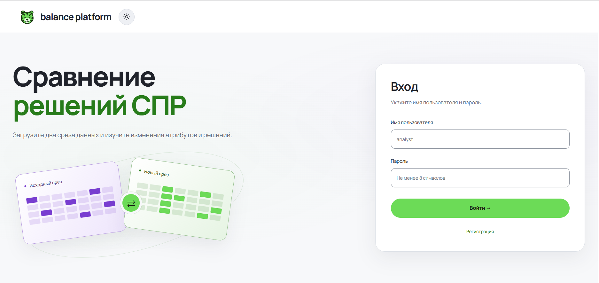
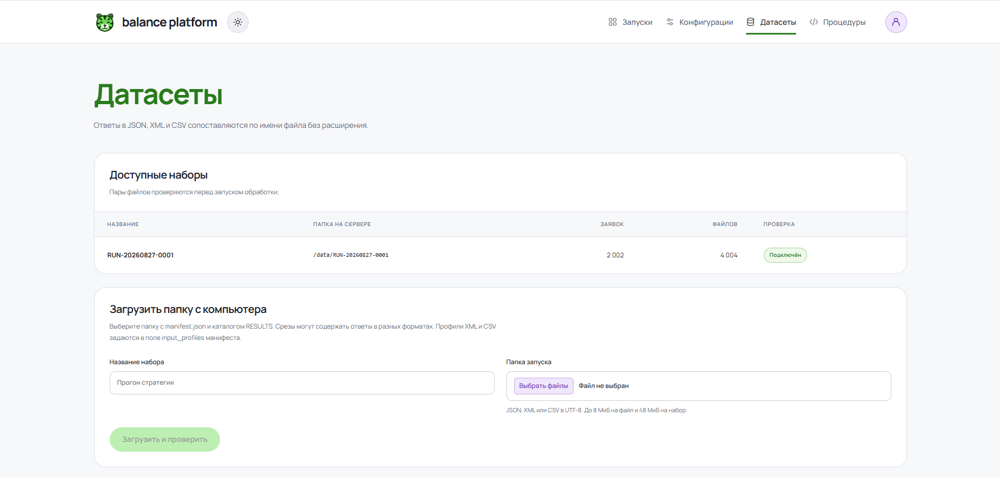
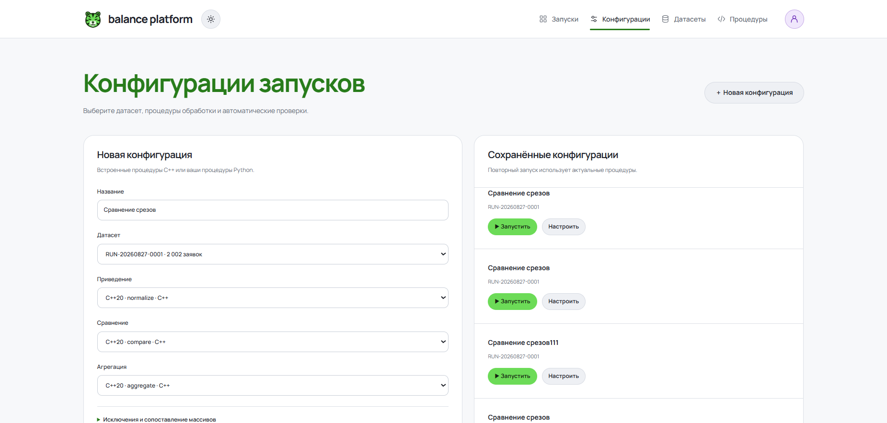
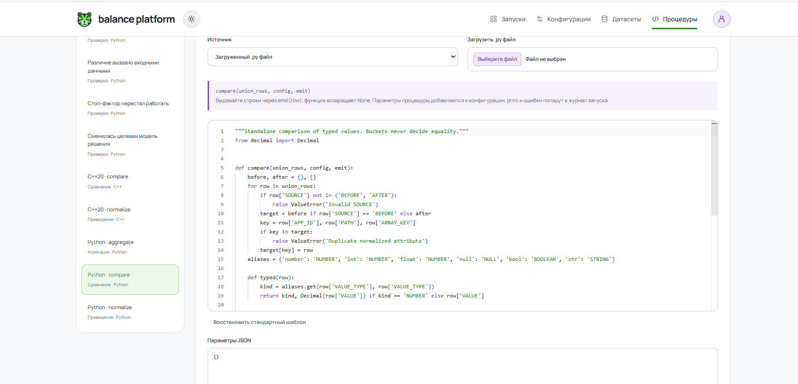
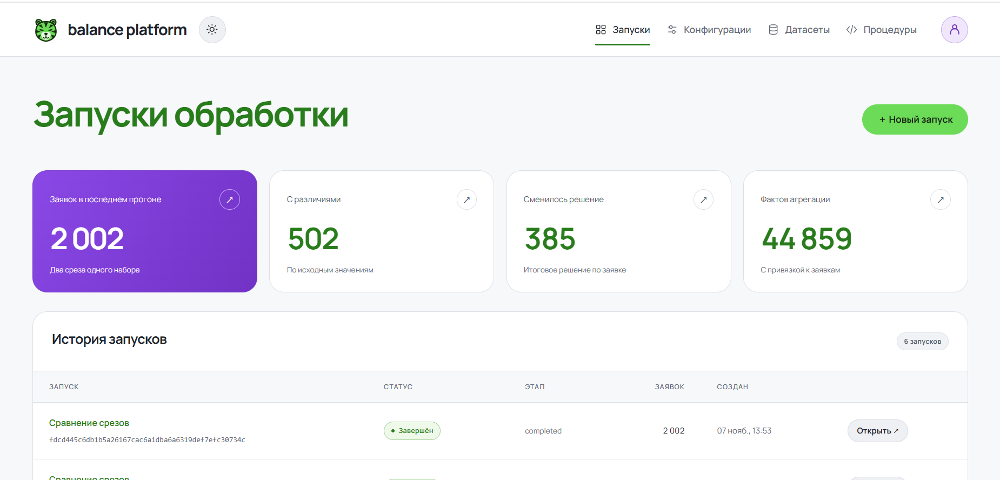
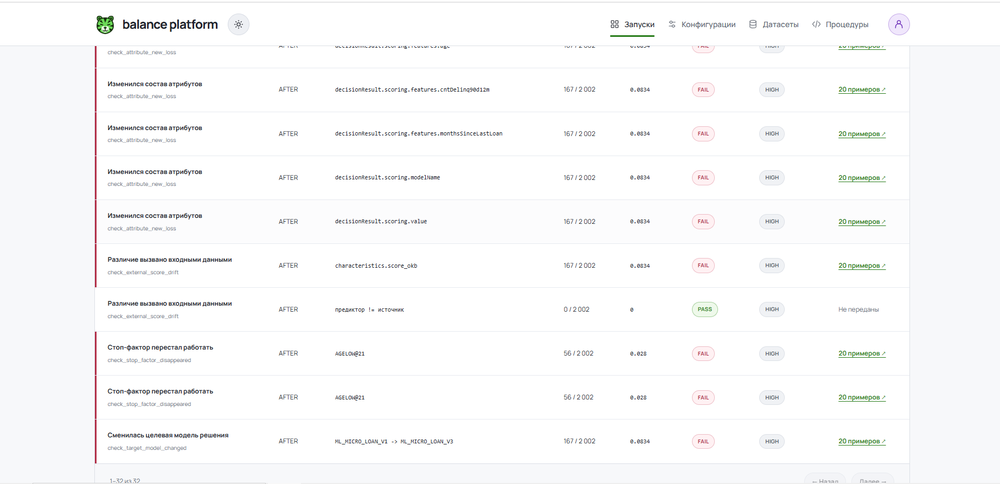

# balance platform

**Команда:** Каширские Тигры

**Задача:** сравнение двух срезов ответов системы принятия решений (СПР), анализ изменений и выполнение проверок.

**Участники:**

- Бессонов Рудольф Сергеевич
- Мазуренко Кирилл Андреевич
- Малахов Алексей Михайлович

## 1. Описание решения

Приложение сопоставляет ответы СПР до и после изменения стратегии. Вложенные документы приводятся к строкам атрибутов, после чего определяются различия значений, появление и исчезновение атрибутов, а также смена итогового решения по заявке.

Пользователь выбирает датасет, процедуры и проверки в конфигурации запуска. Во время обработки доступны этап, счётчики, время и журнал. Результат включает сводную с изменяемыми строками, колонками и фильтрами, переходы к заявкам и значениям BEFORE/AFTER, общий отчёт проверок PASS/FAIL и скачиваемый HTML-отчёт. Процедуры и проверки можно создавать на Python в редакторе либо загружать из `.py`.

## Интерфейс приложения

### 1. Главная страница


### 2. Управление датасетами


### 3. Конфигурация обработки


### 4. Настройка процедур


### 5. Запуск обработки


### 6. Результаты проверок


## 2. Инструкция по запуску

Нужны Git и Docker Engine с Docker Compose v2, для первой сборки также нужен выход в глобальную сеть. Для Python-процедур и проверок необходимо Linux-ядро с Landlock и seccomp; подходит также WSL2 с поддержкой этих механизмов.

```bash
git clone https://github.com/rudosalex4-debug/hachaton_Balance.git
cd hachaton_Balance
docker compose up -d --build
docker compose ps
```

Дождитесь готовности backend и PostgreSQL и запуска frontend и python-worker. Откройте [http://localhost:8088](http://localhost:8088). При первой сборке зависимости скачиваются, а C++ и frontend собираются внутри контейнеров. Миграция БД и регистрация встроенного датасета, процедур и проверок выполняются автоматически.

1. Зарегистрируйтесь: имя пользователя латиницей от двух символов, пароль от восьми.
2. В «Конфигурации» создайте запуск, выберите `RUN-20260827-0001`, оставьте три процедуры `C++20` и стандартные настройки. Убедитесь, что отмечены все пять автоматических проверок.
3. Нажмите «Сохранить и запустить». Во время обработки откройте журнал; после завершения сравните итоговые числа с таблицей выше.
4. В «Сводная» измените измерения строк и колонок, нажмите «Применить раскладку». Число в ячейке открывает список заявок, ссылка заявки - её атрибуты BEFORE/AFTER.
5. В «Проверки» доступны вердикты и примеры заявок. Для своей проверки откройте «Процедуры», создайте Python-процедуру с этапом **«Проверка»**, задайте код или загрузите `.py`, сохраните. Отметьте её в конфигурации и запустите обработку снова.
6. В «Итоговый отчёт» нажмите «Скачать HTML». Откройте файл в браузере; ссылка «Открыть сводную таблицу в приложении» ведёт к тому же запуску. Для перехода приложение должно работать; требуется вход под владельцем запуска.

Порт `8088` можно изменить через `APP_PORT` в `.env`; образец переменных находится в `.env.example`. Встроенный набор подключается из `./data`; другой корневой каталог задаётся через `DATA_DIR` до запуска Compose.

```bash
docker compose logs -f backend python-worker  # диагностика
docker compose stop                         # остановка с сохранением данных
docker compose up -d                         # повторный запуск
```

Пользователи, конфигурации и результаты сохраняются в томе PostgreSQL, загруженные датасеты - в отдельном томе.

Для независимого воспроизведения проверок нужен Python 3 на хосте; дополнительных Python-пакетов эти команды не требуют. Последняя команда запускается при работающем приложении и создаёт собственные тестовые аккаунты и прогоны:

```bash
python3 -m unittest discover -s python-worker/tests -v
python3 tests/reference_oracle.py
python3 tests/integration_reports.py --url http://localhost:8088 --full
```

## 3. Структура репозитория

| Путь | Назначение |
|---|---|
| `backend/` | C++-алгоритмы, HTTP API, фоновая обработка, PostgreSQL, отчёты и тесты ядра |
| `frontend/` | React-интерфейс, редактор процедур, сводная и детализация |
| `python-worker/` | Исполнение Python-процедур, пять выданных проверок, песочница и тесты |
| `database/migrations/` | Схема PostgreSQL, применяемая при старте backend |
| `data/RUN-20260827-0001/` | Полный выданный датасет и его манифест |
| `tests/` | Независимый расчёт по исходным JSON, тестовые данные и API-проверки |
| `configs/default.json` | Пример стандартных настроек; настройки прогона сохраняются через приложение |
| `docs/` | Контракты данных и процедур, описание форматов и результаты проверок |
| `docker-compose.yml`, `start.sh` | Сборка и запуск сервисов |

## 4. Используемые технологии

- **Обработка и API:** C++20, g++, CMake, Drogon, simdjson, JsonCpp, libxml2, libpqxx, OpenSSL.
- **Хранение:** PostgreSQL 16; массовая загрузка строк через COPY, индексы и SQL-агрегации.
- **Пользовательские процедуры и проверки:** Python 3.12, SQLite для индексированного доступа проверок к витрине, Linux Landlock и seccomp для изоляции.
- **Интерфейс:** React 19, TypeScript, Vite, TanStack Query, Monaco Editor.
- **Развёртывание и проверки:** Docker Engine, Docker Compose v2, nginx, GoogleTest/CTest, Python unittest, Playwright.

## 5. Данные

В Git включён выданный набор `RUN-20260827-0001` (2 002 заявки, 4 004 JSON-файла). Для каждой заявки есть два документа с одинаковым именем файла в `RESULTS/BEFORE_MASTER` и `RESULTS/AFTER_BETA`. `manifest.json` описывает расположение срезов и число заявок. Дополнительные внешние данные не использовались; отдельно скачивать датасет не требуется.

Перед обработкой проверяются комплектность пар, формат документов и идентификаторы заявок. Стандартная конфигурация исключает технические поля `appData.request_id` и `appData.createDateTime`. Для массивов задаются ключевые поля или сопоставление по индексу; числовые бакеты используются при группировке, а различия определяются по исходным значениям и типам.

## 6. Архитектура и подход

React обращается к HTTP API Drogon через nginx. Backend ставит запуск в фоновую очередь; состояние, журнал и результаты хранятся в PostgreSQL. Обновление страницы повторно загружает тот же запуск с сервера.

1. **Приведение:** документ разворачивается в строки с `APP_ID`, `PATH`, `ARRAY_KEY`, типом и значением. Ключи массивов позволяют сопоставлять элементы независимо от их порядка, если это задано конфигурацией.
2. **Сравнение:** строки двух срезов сопоставляются по заявке, пути и ключу массива. Формируются `SAME`, `VALUE_CHANGED`, `ATTRIBUTE_NEW`, `ATTRIBUTE_LOST`. Отсутствующий атрибут отличается от `null`, пустой строки, `false` и `0`.
3. **Агрегация:** строки группируются по выбранным измерениям; `CNT` считает уникальные заявки. Сводная запрашивает сохранённые данные через `COUNT(DISTINCT app_id)`, без повторного приведения документов.
4. **Проверки:** отдельный worker получает витрину и код через NDJSON-файлы общего тома. Контракт `CHECK` предоставляет доступ к атрибутам и заявкам через `MartAPI`. Включены проверки падения Approval Rate, появления/исчезновения атрибутов, изменения внешнего скора, исчезновения стоп-фактора и смены целевой модели.
5. **Отчёт:** сохраняются результаты проверок, итоговые показатели и снимок использованного кода с параметрами. Из отчёта доступны сводная, заявки и HTML-экспорт со ссылками обратно в приложение.

C++ используется для основных этапов обработки; Python позволяет менять процедуры и проверки без пересборки backend. PostgreSQL хранит результаты между запросами и обеспечивает группировку и детализацию. Отдельный worker ограничивает доступ пользовательского кода к файловой системе, сети и ресурсам процесса.

## 7. Эксперименты и результаты

Независимый расчёт по исходным JSON, Python-шаблоны и полный HTTP-прогон приложения дали одинаковые количества заявок с различиями и сменой решения. Отдельно проверены четыре типа изменений, уникальность заявок при группировке, подключение пользовательской проверки и сохранение прежнего результата после изменения её кода.

Результат полного прогона 7 ноября 2026 года со стандартными настройками обработки, тремя C++-процедурами и пятью выданными проверками (`app_ids_limit=2`):

| Показатель | Значение |
|---|---:|
| Обработано заявок | 2 002 |
| Заявок с различиями | 502 |
| Заявок со сменой решения | 385 |
| Различия при прежнем решении | 117 |
| Нормализованных строк двух срезов | 572 221 |
| Строк сравнения | 289 533 |
| `SAME` | 275 121 |
| `VALUE_CHANGED` | 7 567 |
| `ATTRIBUTE_NEW` | 3 835 |
| `ATTRIBUTE_LOST` | 3 010 |
| Агрегированных фактов | 44 588 |
| Строк отчёта пяти проверок | 32 |
| Полный цикл, включая проверки и сохранение | 129,641 с |

Замер выполнен на Linux 7.1.5+kali, AMD Ryzen 5 3600X, 16 ГБ RAM, Docker Engine 28.5.2. Запрос сводной по срезу и типу изменения занял 0,338 с.

## 8. Ограничения и дальнейшее развитие

- Применение новой проверки сейчас повторяет весь прогон. Следующее улучшение - запуск проверок по сохранённой витрине без повторного приведения и сравнения.
- Сообщения Python-процедур попадают в журнал после их завершения. Нужна передача этих сообщений во время исполнения; этапы и счётчики C++ уже обновляются в процессе.
- Перезагрузка страницы не останавливает обработку. Перезапуск самого backend прерывает активные прогоны: они помечаются ошибкой и требуют повторного запуска.
- `APP_IDS` в отчёте проверок - примеры, ограниченные `app_ids_limit`, а не полный список срабатываний. Полный состав ячейки сводной доступен отдельно с пагинацией.
- Сводная отображает страницу из 100 групп; отсутствующая на текущей странице группа не означает нулевое количество. Для больших раскладок нужны фильтры или переход между страницами.
- Без Landlock/seccomp Python-код не исполняется. Дальнейшая работа включает проверку поставки на чистой машине и сокращение времени полного цикла.
